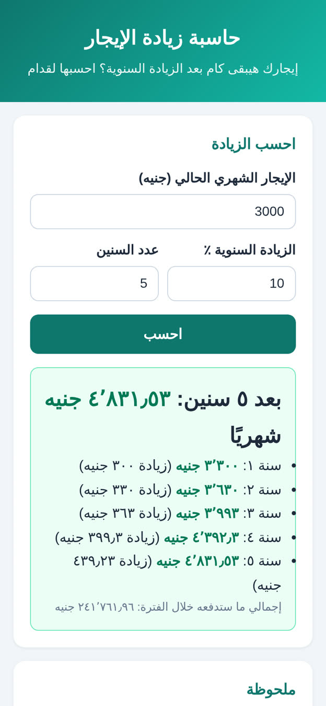

# Rent Increase Calculator | حاسبة زيادة الإيجار

See what your rent becomes after annual percentage increases: year-by-year table and the total you will pay over the period. Arabic interface.

**Live app:** https://abood-ayman.github.io/rent-increase-ar/

**LinkedIn:** [Project entry](https://www.linkedin.com/in/abdullah-ayman-1678b737b/details/projects/)

This is a personal project, built with AI tools.

## Features
- Annual increase as a percentage you enter (like the 10% common in contracts)
- Rent in any future year (1 to 10 years ahead)
- Year-by-year table with the new rent and the increase amount
- Total you will pay over the whole period

## Note
Guidance only: the legal increase depends on your contract type (old or new rent law) and its written terms. Check your contract and the applicable law before any agreement.

## Privacy
Everything runs in your browser. No data is stored or sent anywhere.

## Run locally
Open `index.html` in any browser. It is a single static page with no dependencies.

## Status
Stable.

## Copyright
MIT License - Copyright (c) 2026 Abdullah Ayman.
